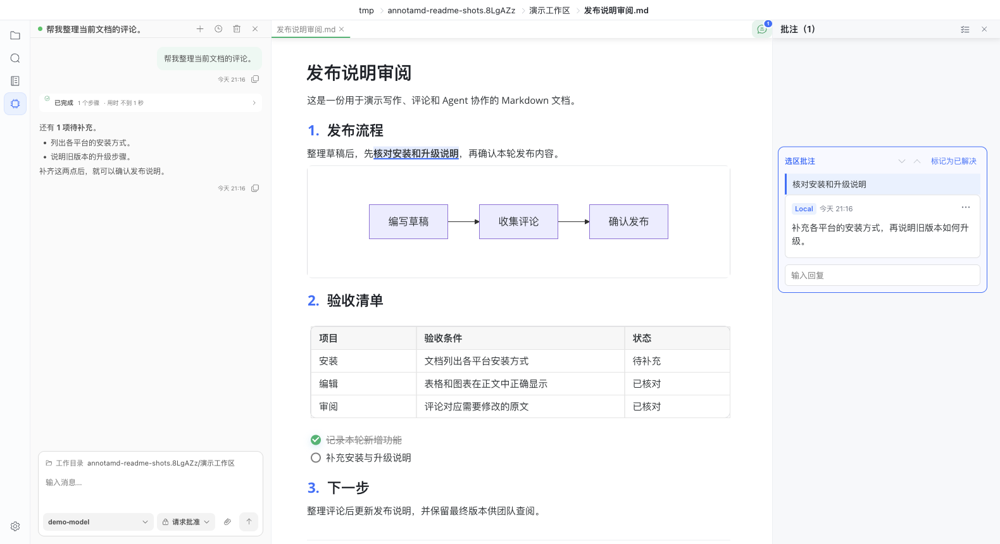
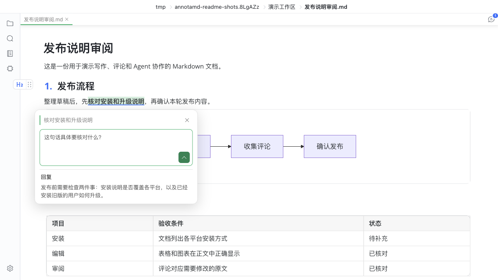

<h1 align="center">AnnotaMD</h1>

<p align="center">
  <strong>本地优先的所见即所得 Markdown 编辑器</strong><br/>
  在同一份 Markdown 文档里写作、批注、画图，并用内置 Agent 审阅和修改正文。
</p>

<p align="center">
  <a href="https://github.com/TyroneXie/AnnotaMD/releases"></a>
  <a href="./LICENSE"></a>
  
  
  
</p>

<p align="center">
  <a href="#下载安装">下载安装</a> ·
  <a href="#评论与审阅">评论与审阅</a> ·
  <a href="#内置-pi-agent">内置 Agent</a> ·
  <a href="#选区询问-ai">询问 AI</a> ·
  <a href="#markdown-编辑与图表">Markdown 编辑与图表</a>
</p>



截图使用[演示 Markdown](docs/assets/annotamd-readme-showcase.md)和本地模拟模型服务。下文展示当前源码中的功能，安装包功能以对应版本的发布说明为准。

## 下载安装

从 [GitHub Releases](https://github.com/TyroneXie/AnnotaMD/releases) 下载对应平台的安装包。支持 macOS（Apple 芯片 / Intel）、Windows（x64 / arm64）和 Linux（x64）。macOS 首次打开时的提示和升级方式见[对应版本的发布说明](docs/releases/)。

打开已有 Markdown 文件或文件夹，即可编辑、搜索和批注。要使用 AI，在「设置 → Agent」添加服务商、填写 API 密钥，并启用至少一个模型。可以从服务商获取模型列表后勾选需要的模型，也可以手动填写模型 ID。

## 评论与审阅

- **选区评论和全文评论**。划选文字后点工具栏里的评论按钮，或在评论栏添加对整篇文档的意见。选区可以跨段落和列表，评论会保留对应的原文引用。
- **正文与卡片双向定位**。点带批注的文字或右侧卡片，可定位对应的另一端，也可在上一条和下一条评论之间跳转。长文档滚动时，评论随正文锚点移动，重叠的卡片会错开。
- **线程回复与处理**。在同一条评论下继续讨论，查看原评论以及 Local、Agent 的历史回复。可在处理后将评论标记为已解决。评论和回复独立保存在本机 SQLite，Markdown 文件保留正文和图片引用。
- **外部 Agent 接入**。可选的 AnnotaMD MCP 支持按文档列出评论、读取完整线程和添加回复。[外部接入说明](tools/annotamd-mcp/README.md)

## 内置 Pi Agent

从左侧活动栏打开 **AI 助手**。它适合跨多轮审阅整篇文档，例如「根据这篇文档的所有评论列出待修改项」，也可以继续要求按审阅意见修改正文。

- **文档上下文**。内置 Pi 按当前文档读取全文、评论和完整回复，应用内部直接提供这些数据。划选后点击工具栏里的回形针「引用到 Agent」，可以把文字加入侧栏草稿，随下一条消息发送。
- **模型与服务商**。支持 OpenAI 兼容接口和 Anthropic Messages，可选择 DeepSeek、OpenAI、Claude、Gemini、Ollama 等预设或填写自定义地址。侧栏可切换已启用的模型，并选择模型支持的思考强度。
- **对话与执行过程**。支持流式回复、常用文档任务、文本附件、新建和搜索历史会话。可以查看工具执行过程、复制回复、停止运行或重试。
- **修改审阅**。使用「请求批准」控制文档写入，查看改动差异，并选择保留或回退本轮文档修改。

Pi 随应用安装并在后台运行。使用 AI 时，任务所需的上下文会发送到所配置的模型服务。

## 选区询问 AI

划选正文，点击浮动工具栏上的 **询问 AI**，直接在选区旁输入问题或改写要求。

每次询问独立使用选中文字、前后文和位置作为上下文。问答结果会显示在浮层内，明确要求改写时可将结果应用到对应选区，并通过编辑器撤销。



## Markdown 编辑与图表

| 功能 | 可以做什么 |
| --- | --- |
| **所见即所得和源码模式** | 直接编辑渲染后的标题、列表、引用和表格。通过「视图 → 源码模式」编辑原始 Markdown，使用连续行号、查找和替换。 |
| **块编辑与文字格式** | 用块菜单、快捷插入和选区工具栏调整段落、标题、代码块、引用、待办和高亮块。支持加粗、斜体、下划线、删除线、链接和文字颜色，可将块内容复制为 Markdown 或纯文本。 |
| **标题与长文档导航** | 支持 H1–H6 自动层级编号、继续或重设编号、章节折叠和大纲定位。 |
| **表格** | 增删行列、设置对齐、拖动列宽、横向滚动和吸顶表头。单元格支持换行、图片、链接及常用格式。 |
| **图片与链接** | 支持拖放和粘贴图片、四角缩放、对齐、复制、下载和行内图片，可设置图片保存目录或上传方式。粘贴独立 URL 可切换原始链接与网页标题，普通行内链接可直接编辑。 |
| **代码、公式与 HTML** | 代码块支持语言选择、语法高亮、行号、换行和复制。支持数学公式、脚注、Emoji、YAML Front Matter 和 HTML 块预览。 |
| **Mermaid 与其他图表** | 文档内渲染 Mermaid，支持图表、源码与并排视图，并可全屏查看和缩放。也支持 Vega-Lite、PlantUML、Flowchart.js 和 Sequence Diagram。 |

## 桌面工作流

- **多文件与多工作区**。同时打开多个文件夹和文档标签页，在文件树、大纲和文件夹全文搜索之间切换。文件树可按名称、创建时间或修改时间排序。
- **保存与外部变更**。支持自动保存、磁盘文件变更自动重载和会话恢复。正文可继续用其他 Markdown 工具编辑。
- **导入、导出与打印**。安装 Pandoc 后可导入 Word、HTML、LaTeX 等文档。支持导出 HTML、PDF，以及直接打印。
- **可调的阅读与编辑界面**。支持浅色和深色主题、自定义主题、图标主题、多语言、字体与留白设置、可配置的快捷键、专注模式和打字机模式。
- **应用内更新**。支持检查更新，macOS 可在应用内下载并重启安装更新。

## 开发

需要 Node.js 20.19+ 和 pnpm 10。仓库的 `packageManager` 字段记录了对应的 pnpm 版本。

```bash
pnpm install
pnpm dev
```

### 用指定文档启动开发版

```bash
ANNOTAMD_OPEN_FILE=/absolute/path/to/document.md pnpm dev
```

### 验证与构建

```bash
npm run verify:quick
npm run verify:feature
npm run verify:agent
pnpm build
```

| 目录 | 内容 |
| --- | --- |
| [`packages/desktop/`](packages/desktop/) | Electron 桌面应用、评论存储、Pi 集成 |
| [`packages/muya/`](packages/muya/) | Muya 所见即所得编辑器 |
| [`tools/annotamd-mcp/`](tools/annotamd-mcp/) | 可选的外部 Agent 评论接入 |
| [`docs/`](docs/) | 开发资料、演示文档和发布说明 |
| [`scripts/`](scripts/) | 验证与构建脚本 |

## 致谢与许可

AnnotaMD 使用 Muya 开源编辑器内核，并集成了 Pi。项目采用 [MIT License](LICENSE)，依赖版权和许可见[第三方声明](THIRD-PARTY-NOTICES.txt)。
